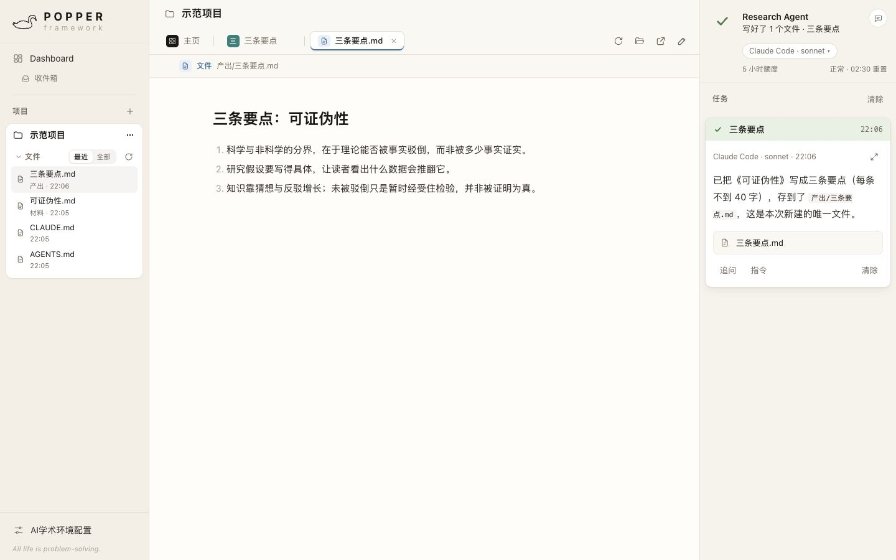
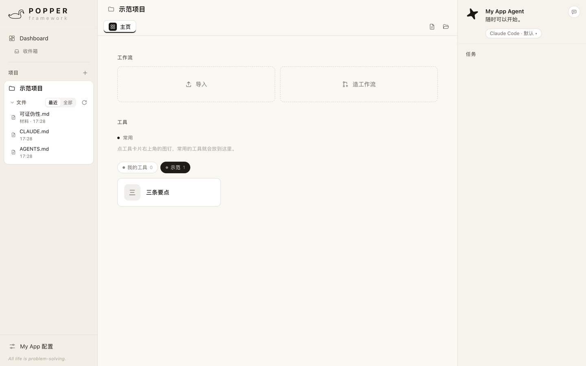
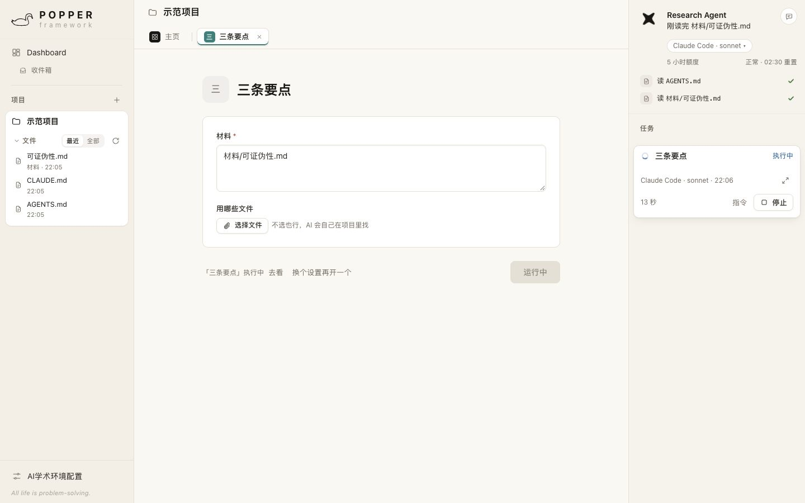
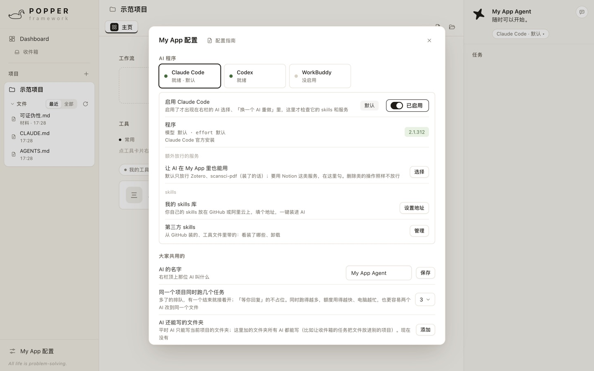

<p align="center">
  <picture>
    <source media="(prefers-color-scheme: dark)" srcset="docs/images/logo-dark.svg">
    
  </picture>
</p>

<p align="center">
  <b>做你自己的 AI 学术工作台。</b><br>
  本地运行 · 用你自己的 Claude Code / Codex · 产出落到你的文件夹<br>
  <i>All life is problem-solving.</i> —— Karl Popper
</p>

<p align="center">
  <a href="LICENSE"></a>
</p>

<p align="center">
  <a href="#快速开始">快速开始</a>
  &nbsp;·&nbsp;
  <a href="#改成你自己的">改成你自己的</a>
  &nbsp;·&nbsp;
  <a href="#做成独立-app">做成独立 App</a>
  &nbsp;·&nbsp;
  <a href="#和-popper-的关系">和 POPPER 的关系</a>
</p>



POPPER Framework 是 [POPPER · AI学术工作站](https://github.com/qiaomiaojoe/ai-academic-app) 的框架：界面、设置、布局都和 POPPER 一样，项目、收件箱、待办、任务、跟 AI 说、配置页一样不少，只是**不带课程的工作流和工具**。

它不是一个做好的成品，而是一个**让你的 AI 来改的底座**。你在 Claude Code 或 Codex 里说一句「加一个工具：读项目里的 PDF，列出每篇的研究问题」，刷新一下，你的工作台就多了一样东西。不用会写代码。

<table>
<tr>
<td width="33%" valign="top"><b>🧱 骨架现成</b><br>三栏界面、项目、任务队列、实时动作流、⌘K、收件箱梳理、待办、配置页，一个学术工作台该有的都在。你只加你自己的方法。</td>
<td width="33%" valign="top"><b>🤖 用你已有的 AI</b><br>交给你电脑上装好、登录好的 Claude Code、Codex 或 WorkBuddy，花的是你自己的订阅额度。不用 API key，没有账号，不连任何服务器。</td>
<td width="33%" valign="top"><b>🔒 都在你手里</b><br>只在你自己的电脑上运行；项目、产出、设置都存在本机。只用 Node.js 自带的功能，不装任何第三方包。</td>
</tr>
</table>

---

## 一个工作台该有的，它都有



- **项目**：每个项目一个文件夹，左栏直接看文件；新建项目时自动写好给 AI 看的项目说明（AGENTS.md），AI 按里面的「文件放哪」放产出。
- **工具**：填几个 AI 猜不到的输入，点「执行」。框架带一个示范工具「三条要点」，照它的样子写一个 JSON 文件，就是你的新工具；也可以在界面上「添加工具」。
- **工作流**：一个独立的网页，把几步事情串起来，在隔开的页面里运行，碰不到工作台本身。自己造：点「导入」旁边的「造工作流」，说清楚从哪做到哪、想用哪些 skill，AI 先排好每一步给你看，你说可以再造成工作流网页，导入就能用。
- **Dashboard、收件箱、待办**：零散文件拖进收件箱，点「一键梳理」，AI 写好每个文件放哪的计划，就摊在 Dashboard 里：不合适的直接改，或者在计划下面跟 AI 说，满意了点「照这样做」，能撤销。要做的事放进待办，以后一键开始。
- **跟 AI 说**：右上角的气泡，随时交代一件事，可以拖文件、粘贴截图。

## AI 在做什么，看得见



点「执行」，指令连同项目信息一起交给你的 AI。右栏一行行出现它正在做的事：读了哪个文件、写了哪个文件、调用了哪个 skill；写好的文件马上出现在左栏，点开就在中间看。

- **排队、停止、追问、重试**：同一个项目的任务自动排队，可以设同时跑几个；出错时把报错翻成人话，一键重试或换一个 AI 重做。
- **等你拍板**：AI 有问题要问，任务变成「等你回复」，回复之后接着做。
- **留痕**：每次交给 AI 的指令原文、回复、产出都记下来，随时能查。

## 用你已有的 AI，接你自己的 skills



左下角「My App 配置」一页管所有设置（My App 是你的 App 的名字，改了名就跟着变；右栏那位 AI 默认也叫「My App Agent」）：

- **AI 程序**：Claude Code、Codex、WorkBuddy（腾讯，国内账号就能用），启用哪个、默认用哪个、各自的模型；Claude Code 的 5 小时额度直接显示。
- **我的 skills 库**：你写的 skills 放在自己的 GitHub 仓库或阿里云 OSS 上，填个地址，一键装进 AI、一键更新。步骤见配置页里的「配置指南」。
- **Roughdraft、MinerU**：md 文件在浏览器里批注、PDF 转成带页码的文字稿，用得到的点「怎么装」。
- **版本**：你的 App 名字、版本号和你的署名，到手是「My App · 外壳 0.0.0 · 内容 0.0.0」，改成你自己的；下面单独一行「Built with POPPER framework」、用的框架版本和项目地址。

框架不带文献工具（数据库检索 skills、scansci-pdf、Zotero、OpenAlex、pandoc）。要用的话自己装进 AI 程序；是 MCP 服务的，在「额外放行的服务」里勾上。

---

## 快速开始

要先装好 [Node.js](https://nodejs.org)（18 或更新），以及 Claude Code、Codex、WorkBuddy 里的至少一个，并在终端里登录过一次。

1. 下载这个仓库：右上角「Code → Download ZIP」解压，或者
   ```bash
   git clone https://github.com/qiaomiaojoe/popper-framework.git
   ```
2. 双击启动：Mac 双击 `启动.command`，Windows 双击 `启动.bat`。会弹出一个黑窗口，浏览器自动打开。
3. 左栏「项目」右边点 +，新建一个项目；在主页「工具 → 示范」里打开「三条要点」，粘一段文字，点「执行」。

第一次启动遇到的问题（Mac 说无法打开、Windows 蓝色提示、找不到 AI 程序……）见 [说明.md](说明.md)。

## 改成你自己的

在 Claude Code 或 Codex 里打开**这个文件夹**，像跟人说话一样提要求：

- 「把左上角 Framework 那行小字改成我的名字」
- 「照着示范工具，加一个工具：读项目里的 PDF，列出每篇的研究问题」
- 「把配色改成蓝色系」
- 「新建项目时，『文件放哪』按 选题 / 文献 / 数据 / 写作 分文件夹」

AI 会先读 [AGENTS.md](AGENTS.md)：哪个文件管什么、改完怎么看效果、改之前先备份到 `改动备份/`、一次只改一处、哪些地方不能动。改了界面刷新浏览器就能看到；改了 `.cjs` 文件要关掉黑窗口、重新启动。

改坏了也不怕：让 AI「把刚才那处改回去」，或者重新下载一份。你的项目和产出不在这个文件夹里，不会丢。

## 做成独立 App

想要一个双击就开、不用开黑窗口的 App：

1. （可选）让 AI 把 `package.json` 里的 `productName` 改成你的 App 名、`author` 改成你的名字，版本号改成你自己的，换掉 `构建素材/` 里的图标。
2. 装一次打包工具（要下载约 100MB，国内用镜像）：
   ```bash
   ELECTRON_MIRROR=https://npmmirror.com/mirrors/electron/ npm install --registry=https://registry.npmmirror.com
   ```
3. 双击 `打包App.command`（Windows：`打包App.bat`），几秒钟后 App 在 `打包输出/` 里。

没有付费签名：拷到别的电脑上，Mac 要在「系统设置 → 隐私与安全性」点「仍要打开」，Windows 要点「更多信息 → 仍要运行」。详细步骤见 [说明.md](说明.md)。Windows 的启动和打包脚本还没在 Windows 上实测过。

## 它怎么保护你

- 本地服务只听本机（127.0.0.1），别的电脑连不上。
- 每次启动生成新的登录令牌，只认带令牌打开的页面；别的网页调不动你的 AI、读不到你的文件。
- 每个工作流在单独的地址里运行，碰不到工作台的页面、接口和登录凭证，也碰不到别的工作流。
- Claude Code、Codex 在 Mac 上开着沙箱：AI 跑的命令只能写当前项目的文件夹。Windows 上的 Claude Code 没有这个沙箱。
- 删文件只移进废纸篓。

## 目录

| 路径 | 是什么 |
| --- | --- |
| `app/` | 外壳：本地服务和守门（`kernel.cjs`）、独立 App 的窗口（`main.cjs`） |
| `content/` | 界面（`ui.js`、`ui.css`）、项目、任务、调 AI 的引擎、工作流的桥、示范工具 |
| `启动.command` / `启动.bat` | 浏览器版，双击启动 |
| `打包App.command` / `打包App.bat` | 打成独立 App |
| `AGENTS.md` / `CLAUDE.md` | 给你的 AI 看的说明 |
| `说明.md` | 给你看的使用说明 |

## 和 POPPER 的关系

[POPPER · AI学术工作站](https://github.com/qiaomiaojoe/ai-academic-app) 是乔淼PhD「AI学术训练营」的学术工作台，带三条完整的论文工作流（SCI·SSCI 论文、综述文章、期刊投稿）和二十多个工具，方法来自训练营打磨过的 [skills](https://github.com/qiaomiaojoe/ai-academic-workflow)。

POPPER Framework 是它下面那一层：同一套界面和运行方式，拿掉了课程内容，留给你装自己的方法。两个各用各的数据，可以同时装、同时开。

## 许可证

以 [Apache License 2.0](LICENSE) 开源：可以用、改、再发布，包括商用；再发布时保留版权声明和 [NOTICE](NOTICE)，并标明改了哪些文件。

「POPPER」名称和黑天鹅图标不在授权范围内。对外发布你的修改版时，请换上你自己的名字和图标（`package.json` 的 `productName`、`author`，`content/ui.js` 里的 `BRAND` 和 `LOGO`，`构建素材/` 里的图标）。配置页「版本」下面那行「Built with POPPER framework」，请保留。

内含的第三方组件：[PDF.js](https://github.com/mozilla/pdf.js)（Apache-2.0）。

© 2026 乔淼PhD · 公众号「乔淼PhD」

---

<sub><b>English</b> — POPPER Framework is the open skeleton of POPPER, a local-first academic workbench. It runs on your own machine, hands tasks to the Claude Code / Codex / WorkBuddy you already use, and writes results into your project folders. No accounts, no servers, no third-party npm packages. Licensed under Apache-2.0; the POPPER name and swan logo are not covered by the license. It ships without course workflows and tools: you reshape it into your own workbench by asking your AI to edit it. The interface and docs are in Chinese.</sub>
